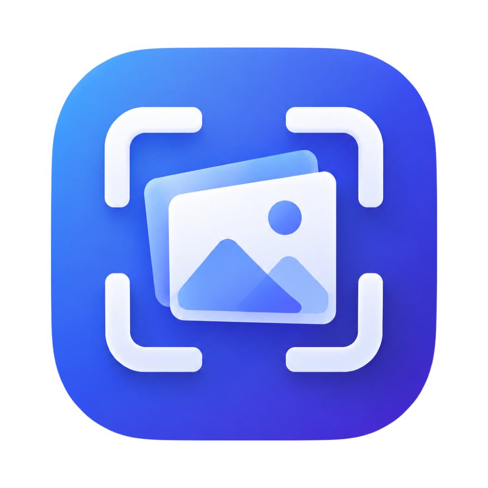
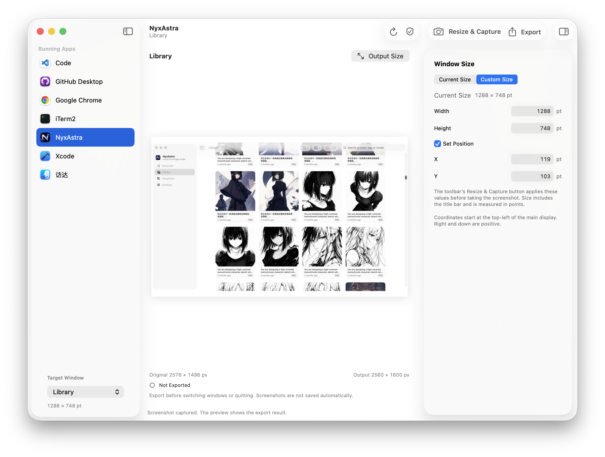

  

# FrameKit — Window Screenshots for Mac

**Resize the window. Capture the screenshot. Export the right pixels.**

A free, native macOS tool for developers and creators who need consistent screenshots of apps, browser extensions, and websites. Set a window's size before capture, preview the result, and export a PNG with the exact dimensions your layout needs.

**[Get FrameKit on GitHub Releases](https://github.com/GavinHarbus/FrameKit/releases)** · [Product website](https://gavinschneestudio.org/products/framekit.html) · [Support](https://gavinschneestudio.org/contact.html)

**Free · macOS 14+ · Apple Silicon & Intel · English & Simplified Chinese**

## Screenshots for the work you ship

- **App listings:** keep window layouts consistent across screenshots for the Mac App Store and product directories.
- **Browser extensions and web apps:** showcase Chrome extension pages, side panels, dashboards, and websites.
- **Product launches and documentation:** create images for landing pages, tutorials, release notes, and social posts.

## From window to PNG in one workflow

| Feature | What it does |
| --- | --- |
| Precise window sizing | Set width, height, and optional screen position before capture. |
| Actual-size verification | Read back the result so you can see when an app applies its own size limits. |
| Window selection | Choose a running app and its window without capturing your whole desktop. |
| Preview and retake | Check the image and capture again with the same size settings. |
| Exact PNG dimensions | Keep the original size or use fit with white padding, center crop, or stretch. |
| Descriptive filenames | Include the app name, captured window title, and output dimensions. |

All screenshot processing stays on your Mac. No account, API key, or cloud upload is needed.

## Three steps to your screenshot

1. **Choose a window.** Select the app or browser window you want to show.
2. **Set the size and capture.** Use its current dimensions or enter a custom window size.
3. **Preview and export.** Retake if needed, then save at original or custom pixel dimensions.

Screen Recording permission enables capture. Accessibility is only needed to resize or move windows.

## A few useful details

- **Window size and image size are different.** Window dimensions use points and change the app's layout. Output dimensions use pixels and change the saved image.
- **Some apps limit their window size.** FrameKit checks the actual dimensions instead of assuming every resize succeeds.
- **Browser screenshots include the toolbar.** Show extension content in a tab or side panel. Full-page scrolling capture is not supported.
- **Export the images you want to keep.** The latest capture is held in memory. A successful retake, an explicit app/window switch, or quitting replaces or clears it; exported PNGs remain where you saved them.

[Privacy policy](https://gavinschneestudio.org/privacy.html#framekit) · [Terms](https://gavinschneestudio.org/terms.html#framekit)

## Help shape FrameKit

[Report a bug or suggest a feature](https://github.com/GavinHarbus/FrameKit/issues) · [Build from source](docs/DEVELOPMENT.md) · [Contact support](https://gavinschneestudio.org/contact.html)

If FrameKit saves you time, star the repository or share the [product page](https://gavinschneestudio.org/products/framekit.html) with another developer.

## License

Source code and documentation use the [MIT License](LICENSE). Logo and app icon artwork have a [separate usage notice](Design/README.md#artwork-license).

Built by [Gavin Schnee Studio](https://gavinschneestudio.org).
